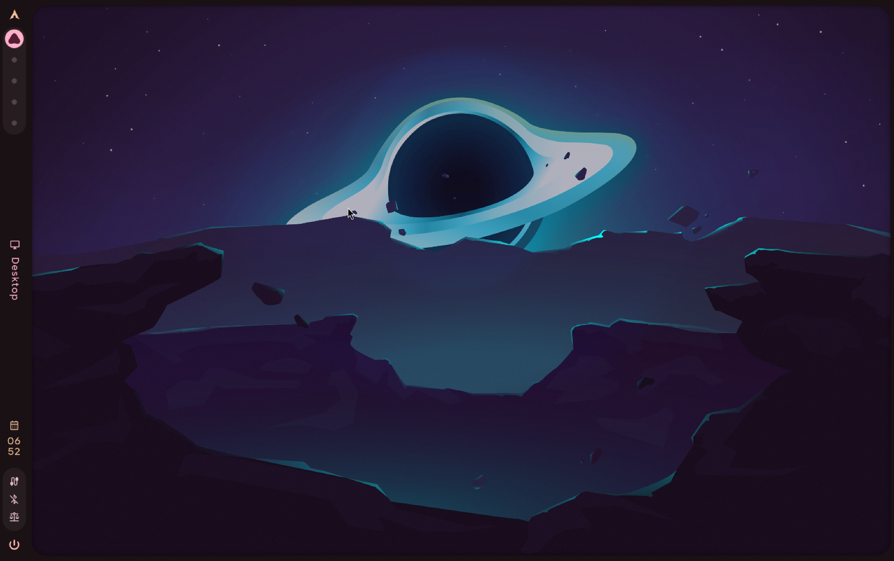
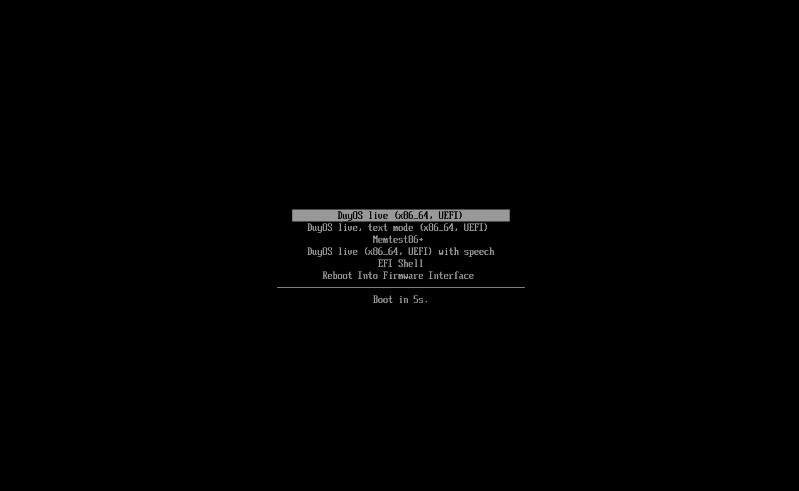
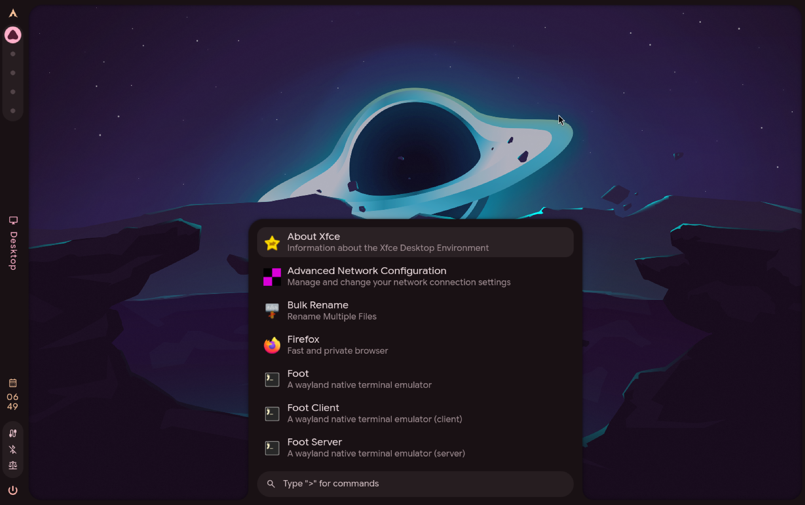
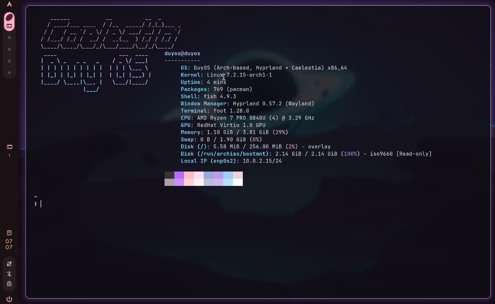
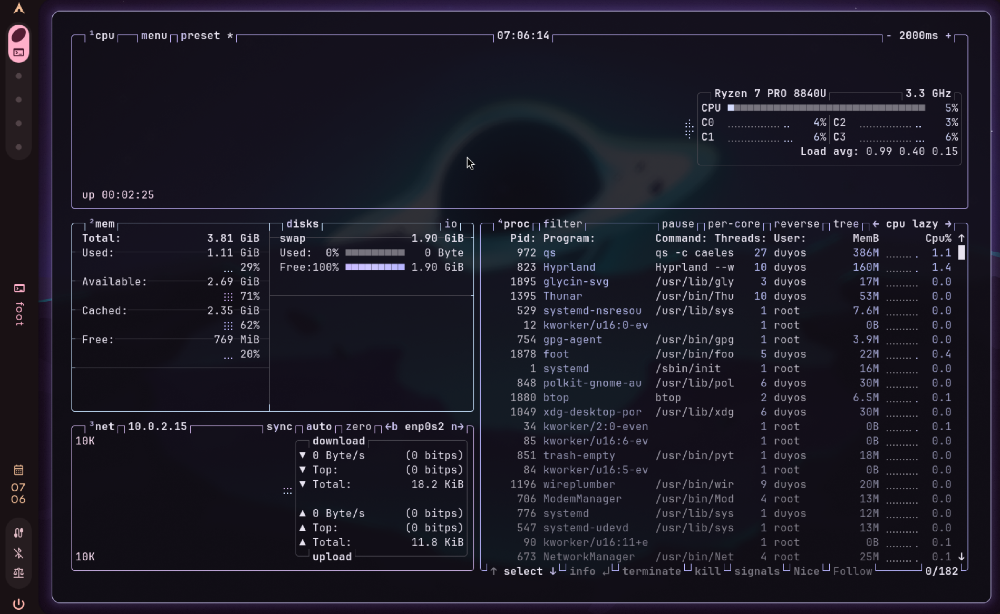

# DuyOS

**DuyOS** is a customized, bootable live Linux distribution based on **Arch Linux**, built with the
official [archiso](https://gitlab.archlinux.org/archlinux/archiso) framework. It boots straight into a
modern **Hyprland** Wayland desktop running the **[Caelestia shell](https://github.com/caelestia-dots/shell)**,
with DuyOS branding, a curated set of applications, and system-level tuning for running smoothly from
RAM and inside virtual machines.



| | |
|---|---|
| **Base** | Arch Linux (rolling release), archiso `releng` profile (archiso v92) |
| **Kernel** | Linux 7.2 (Arch `linux` package) |
| **Desktop** | Hyprland 0.57 (Wayland compositor) + Caelestia shell (Quickshell/QML) |
| **Architecture** | x86_64 |
| **Boot** | UEFI (systemd-boot) and BIOS (syslinux), plus a text-mode fallback entry |
| **Live user** | `duyos` / password `duyos` (passwordless `sudo`) |
| **ISO size** | ~2.2 GB |
| **License** | GPL-3.0-or-later (see [License](#license)) |

## Contents

- [Features](#features)
- [Screenshots](#screenshots)
- [System requirements](#system-requirements)
- [Getting the ISO](#getting-the-iso)
- [Running DuyOS](#running-duyos)
- [Using the live session](#using-the-live-session)
- [Building from source](#building-from-source)
- [Repository layout](#repository-layout)
- [Motivation](#motivation)
- [What DuyOS customizes](#what-duyos-customizes)
- [Reproducibility notes](#reproducibility-notes)
- [Known limitations](#known-limitations)
- [Troubleshooting](#troubleshooting)
- [Credits](#credits)
- [License](#license)

---

## Features

- **Ready-to-use desktop.** Boots straight into Hyprland with the Caelestia shell: bar, app
  launcher, dashboard, notifications, lock screen and Material You colours.
- **Curated apps.** Firefox, Thunar, foot, btop, fastfetch, micro, git and a fish/starship shell.
- **Tuned for live and VM use.** zram compressed swap, sysctl tuning for zram, a zstd-compressed
  image for faster loading, and VM guest tools.
- **Safe defaults.** The desktop runs as an unprivileged user (not root), and SSH is disabled.
- **Fails gracefully.** If the VM has no 3D graphics, DuyOS shows a diagnostic and drops to a
  working console instead of a black screen. A *text mode* boot entry is also available.
- **DuyOS branding.** Its own `os-release` identity, boot menus, boot splash, console banner and
  fastfetch logo.
- **One-command, reproducible build.** It runs in a container on any Linux host, with Caelestia's
  config pinned to a fixed commit.

## Screenshots

| | |
|---|---|
|  **UEFI boot menu** |  **Caelestia app launcher** |
|  **fastfetch with the DuyOS logo** |  **btop: user `duyos`, zram swap** |

More screenshots, with captions, are in [`demo/`](demo/README.md).

---

## System requirements

| | Minimum | Recommended |
|---|---|---|
| CPU | x86_64, 2 cores | 4 cores |
| RAM | 3 GB | 4 GB or more (the live system runs entirely in RAM) |
| Graphics | **3D acceleration is required** (Hyprland is GPU-accelerated) | virtio-gpu with OpenGL (QEMU/virt-manager) |
| Firmware | BIOS or UEFI | UEFI |

Without 3D graphics, DuyOS still boots to a usable text console.

---

## Getting the ISO

**Build it** (see [Building from source](#building-from-source)):

```bash
git clone https://github.com/itssduy/DuyOS.git
cd DuyOS
./source/build.sh          # → out/duyos-YYYY.MM.DD-x86_64.iso
```

If a prebuilt ISO is attached to this repository's
[Releases](https://github.com/itssduy/DuyOS/releases), you can download it instead.

**Verify the checksum** of a downloaded or built ISO. Each build writes a `.sha256` file next to it:

```bash
cd out
sha256sum -c duyos-*.iso.sha256     # should print: duyos-....iso: OK
```

---

## Running DuyOS

### Option 1: QEMU (easiest)

```bash
./source/run-vm.sh            # newest ISO in out/, UEFI, 3D graphics, full screen
./source/run-vm.sh --window   # in a window instead of full screen
./source/run-vm.sh --bios     # test the legacy BIOS boot path
```

This script starts a QEMU/KVM virtual machine with 4 CPUs, 4 GB RAM, UEFI firmware (OVMF) and a
3D-accelerated virtio GPU at your monitor's native resolution. It needs `qemu-system-x86_64`, plus
`edk2-ovmf` for UEFI.

In the QEMU window, **Ctrl+Alt+F** toggles full screen and **Ctrl+Alt+G** releases the mouse and
keyboard. On GNOME, **Super+Esc** also gives keyboard shortcuts back to the host.

### Option 2: virt-manager

1. Copy the ISO somewhere libvirt can read it (SELinux blocks your home folder):
   `sudo cp out/duyos-*.iso /var/lib/libvirt/images/`
2. **New Virtual Machine** → *Local install media* → select the ISO → OS: *Arch Linux*.
3. Memory **4096 MB**, CPUs **4**. Untick *Enable storage* (DuyOS is a live system).
4. Tick **Customize configuration before install**, then:
   - *Overview* → Firmware: **UEFI**
   - *Video* → Model: **Virtio**, tick **3D acceleration**
   - *Display Spice* → Listen type: **None**, tick **OpenGL**
5. Click **Begin Installation**.

### Option 3: VirtualBox / VMware

| Hypervisor | Required graphics setting |
|---|---|
| VirtualBox | Graphics Controller **VMSVGA**, **Enable 3D Acceleration**, 128 MB video memory |
| VMware | **Accelerate 3D graphics** |

### Option 4: Real hardware (USB stick)

> DuyOS has been tested in virtual machines only.

Write the ISO to a USB stick. This **erases the stick**, so double-check the device name with `lsblk`:

```bash
sudo dd if=out/duyos-*.iso of=/dev/sdX bs=4M status=progress oflag=sync
```

You can also use a graphical tool such as Fedora Media Writer, balenaEtcher or Ventoy. Then boot
from the USB stick using your PC's boot menu.

---

## Using the live session

### Booting

| Boot menu entry | What it does |
|---|---|
| **DuyOS live** (default, 5 s timeout) | Starts the Hyprland + Caelestia desktop |
| **DuyOS live, text mode** | Boots to a text console without starting the desktop (`duyos.nodesktop`) |
| DuyOS live … with speech | Accessibility: speakup screen reader |

DuyOS logs in automatically as **`duyos`** (password `duyos`). `sudo` doesn't ask for a password.

> The live system runs from RAM, so **nothing you change is saved after shutdown**.

### Keybindings

These are Caelestia's defaults, plus two DuyOS additions marked ★. Press **Super+/** in DuyOS to see
this list.

| Keys | Action | Keys | Action |
|---|---|---|---|
| **Super** | App launcher | **Super+T** | Terminal (foot) |
| **Super+W** | Browser (Firefox) | **Super+E** | File manager (Thunar) |
| **Super+C** | Text editor (micro) | **Super+Q** | Close window |
| **Super+F** | Fullscreen window | **Super+Alt+Space** | Toggle floating |
| **Super+1…0** | Switch workspace | **Super+Alt+1…0** | Move window to workspace |
| **Super+N** | Sidebar | **Super+K** | Show all panels |
| **Super+L** | Lock screen | **Ctrl+Alt+Del** | Session menu (log out / reboot / power off) |
| **Print** | Screenshot | **Super+Shift+S** | Screenshot a region |
| **Super+V** | Clipboard history | **Super+.** | Emoji picker |
| ★ **Super+/** | DuyOS help (`duyos-info`) | ★ **Super+Shift+B** | btop |

### Useful commands

| Command | Purpose |
|---|---|
| `duyos-info` | System info (fastfetch) and keybinding help |
| `duyos-session` | Start, or retry starting, the desktop from a text console |
| `nmtui` | Connect to Wi-Fi or configure networking |
| `archinstall` | Install **plain Arch Linux** to a disk (not DuyOS; see [Known limitations](#known-limitations)) |
| `cat ~/.local/state/duyos/hyprland.log` | Desktop session log, for troubleshooting |

---

## Building from source

### Requirements

- Any x86_64 Linux host with **podman** (or docker), and `sudo`. Tested on Fedora 44 with podman 5.8.
  On an Arch Linux host you can also build natively.
- About 20 GB free disk space, 8 GB RAM recommended, and an internet connection.
- Time: the **first build takes about 30–60 minutes** because it compiles Quickshell and the
  Caelestia packages from the AUR. Later builds reuse those packages and take about 10–15 minutes.

### Build

```bash
git clone https://github.com/itssduy/DuyOS.git
cd DuyOS
./source/build.sh
```

That is the only command needed. It asks for your `sudo` password, because `mkarchiso` has to mount
`/dev` and `/proc` inside the image it builds, and rootless containers can't do that. Output files
are given back to your user afterwards. The script then:

1. Starts a privileged (rootful) `archlinux:latest` container with the repo mounted at `/duyos`,
   using the host's network.
2. Fully updates the container and installs `archiso`, `base-devel` and `git`.
3. **Builds the AUR packages** (`caelestia-shell`, `caelestia-cli` and their AUR-only dependencies
   such as `quickshell-git`, `qt6-m3shapes-git`, `libcava`) as an unprivileged user with `yay`, and
   publishes them as a local pacman repository at `build/localrepo` (`[duyos-aur]`).
4. Copies `source/profile` to `build/profile`, adds Caelestia's upstream dotfiles **pinned to a fixed
   commit**, and points `pacman.conf` at the local repo.
5. Runs `mkarchiso` and writes the ISO, its SHA-256 checksum and the list of AUR package versions
   to `out/`.

A full log of every build is saved to `out/build-<timestamp>.log`.

To keep a laptop awake during the build:
`systemd-inhibit --what=sleep:idle --why="DuyOS build" ./source/build.sh`

### Options

```bash
./source/build.sh --rebuild-aur          # force rebuilding the AUR packages
CONTAINER_ENGINE=docker ./source/build.sh
./source/build.sh --native               # on an Arch Linux host, without a container
```

---

## Repository layout

```
DuyOS/
├── README.md                  ← this file
├── LICENSE                    ← GPL-3.0
├── source/                    ← all source code for the distro
│   ├── build.sh               ← one-command build (runs in an Arch container via podman)
│   ├── run-vm.sh              ← boots the ISO in QEMU/KVM with 3D graphics
│   ├── aur-packages.txt       ← AUR packages to build (Caelestia)
│   ├── scripts/
│   │   ├── build-all.sh       ← container entry: update tools → AUR → ISO
│   │   ├── build-aur.sh       ← builds AUR packages into a local pacman repo
│   │   └── build-iso.sh       ← adds pinned Caelestia dotfiles, runs mkarchiso
│   ├── branding/
│   │   └── make-artwork.sh    ← regenerates the BIOS boot splash (ImageMagick)
│   └── profile/               ← the archiso profile (forked from releng)
│       ├── profiledef.sh      ← ISO name/label, kernel params, file permissions
│       ├── packages.x86_64    ← package list (DuyOS section at the bottom)
│       ├── pacman.conf        ← adds the local [duyos-aur] repo
│       ├── grub/ efiboot/ syslinux/   ← rebranded boot menus
│       └── airootfs/          ← files overlaid onto the live root filesystem
├── demo/                      ← screenshots, build log and evidence of DuyOS running in a VM
└── old-bootc/                 ← earlier Fedora bootc experiment (not part of the build)
```

Build output (`build/`, `out/`) is not committed.

---

## Motivation

I wanted a distro that is **pleasant to use as a daily desktop out of the box**, rather than a minimal
rescue image. I picked **Arch Linux + archiso** because archiso is the official tool that builds the
real Arch ISO. A DuyOS build is therefore a real, maintained build pipeline, and Arch's rolling repos
give the newest Hyprland and Mesa, which a modern Wayland desktop needs. I picked **Hyprland with the
Caelestia shell** because Caelestia provides a polished, cohesive desktop (bar, launcher, notifications,
dashboard, lock screen, dynamic Material You colours) on top of a fast tiling compositor. Building
it into a live ISO showed what that takes: AUR packaging, Wayland/GPU requirements in VMs, and
configuration layering.

Every change below has a reason, and each one is documented in the file where it is made.

---

## What DuyOS customizes

### 1. Identity and appearance

| Change | Where | Why |
|---|---|---|
| Distro name, `os-release` (`NAME="DuyOS"`, `ID=duyos`, `ID_LIKE=arch`) | `airootfs/usr/share/duyos/os-release`, applied by a build-time pacman hook | `os-release` belongs to Arch's `filesystem` package and can't simply be overlaid (pacman reports a file conflict), so a hook (`etc/pacman.d/hooks/90-duyos-branding.hook`) rewrites it after packages are installed and is then removed from the image. |
| ISO name / volume label / publisher | `profiledef.sh` (`duyos`, `DUYOS_YYYYMM`) | The ISO identifies itself as DuyOS everywhere, including in the firmware boot menu. |
| Rebranded boot menus, shorter timeout (5 s) | `grub/`, `efiboot/`, `syslinux/` | All three bootloaders say "DuyOS live" instead of "Arch Linux install medium". |
| Custom BIOS boot splash; Caelestia's default wallpaper on the desktop | `syslinux/splash.png` (generated by `source/branding/make-artwork.sh`) | The BIOS boot menu shows DuyOS instead of Arch's splash. The desktop keeps Caelestia's built-in space wallpaper, which its default colour scheme is designed around. |
| Hostname `duyos`, coloured login banner (`/etc/issue`), welcome MOTD | `airootfs/etc/` | The console also identifies the system and explains the live credentials. |
| Custom fastfetch logo and module list | `airootfs/usr/share/duyos/logo.txt`, `etc/skel/.config/fastfetch/` | Branded system info in the terminal. |
| Caelestia/Hyprland tuning (`hypr-vars.lua`, `hypr-user.lua`, `shell.json`) | `airootfs/etc/skel/.config/caelestia/` | Points Caelestia at apps DuyOS actually ships (its defaults reference AUR-only `codium`, `pwvucontrol`, `sweet-cursors`), lowers blur/shadow cost for VMs, tighter rounding/gaps, adds `Super+/` (help) and `Super+Shift+B` (btop) keybinds, shows a welcome notification on first login. |

Caelestia's own Hyprland configuration is taken unmodified from upstream at a **pinned commit**.
DuyOS changes it only through Caelestia's documented override files, so upstream and DuyOS changes
stay cleanly separated.

### 2. Included software (on top of the archiso base)

| Package | Purpose |
|---|---|
| **hyprland** + **caelestia-shell/cli** (AUR) | The desktop: compositor and shell |
| **firefox** | Web browser |
| **foot** | Fast Wayland terminal (Caelestia's default) |
| **thunar** | Graphical file manager |
| **btop** | Interactive resource monitor (`Super+Shift+B`) |
| **fastfetch** | System information with the DuyOS logo (`duyos-info`) |
| **micro** | Beginner-friendly terminal text editor (`Super+C`) |
| **git** | Version control |
| **fish** + **starship**, **eza**, **zoxide**, **direnv** | Modern interactive shell setup used by Caelestia's terminal config |
| **pavucontrol**, **pipewire**, **wireplumber** | Audio stack and mixer |
| **networkmanager** (+ `nmtui`, applet) | Networking, required by Caelestia's network widget |
| **zram-generator** | Compressed RAM swap (see below) |
| **spice-vdagent**, plus releng's qemu/VirtualBox/VMware guest tools | VM clipboard sharing and display resize |

The full list is in [`source/profile/packages.x86_64`](source/profile/packages.x86_64). The DuyOS
section is at the bottom.

### 3. System-level modifications

1. **zram compressed swap.** `etc/systemd/zram-generator.conf` creates a zstd-compressed swap device
   sized at half of RAM (max 8 GiB). The live root filesystem already lives in RAM and there is no
   disk swap, so a browser plus a Qt desktop can run a small VM out of memory. zram gives about 2–3x
   effective headroom.
2. **Kernel/VM tuning for zram.** `etc/sysctl.d/99-duyos.conf` sets `vm.swappiness=180` and
   `vm.page-cluster=0` (the recommended values for zram), adjusts watermarks to avoid UI stalls, raises
   inotify limits for desktop apps, and enables basic hardening (`kptr_restrict`, `dmesg_restrict`).
3. **Kernel command line.** `profiledef.sh` adds `zswap.enabled=0`, which stops zswap from compressing
   pages before they reach zram (double work), and `quiet loglevel=3` for a clean boot.
4. **Networking stack replaced.** releng uses `systemd-networkd` + `iwd`. DuyOS switches the live
   system to **NetworkManager** (enabled units in `etc/systemd/system/`), which the Caelestia shell
   needs to show and control networks.
5. **Unprivileged desktop user and session management.** releng logs in as `root` on a console. DuyOS
   ships its own `passwd`/`shadow`/`group`/`gshadow` with a `duyos` user (UID 1000, in `wheel`) and a
   `sudoers.d` rule. The tty1 autologin is changed to `duyos`, and `/etc/profile.d/duyos-autostart.sh`
   runs **`duyos-session`**, a launcher that checks for a GPU render node, starts Hyprland via
   `start-hyprland`, logs to `~/.local/state/duyos/`, and falls back to a diagnostic text console
   instead of crash-looping. A new **`duyos.nodesktop`** kernel parameter (the "text mode" boot entry
   in all three bootloaders) skips the desktop entirely.
6. **Hardening the live image.** releng enables `sshd` with an empty root password. DuyOS disables it,
   because a desktop ISO with a published password should not expose SSH by default.
7. **Faster live system.** The squashfs image uses **zstd** instead of xz. The ISO is about 10% larger,
   but decompression is much faster, so boot and app launch are quicker when running from RAM or USB.

### 4. Upstream vs. DuyOS

- **Unmodified upstream:** the archiso tool itself, Arch packages, Caelestia shell/CLI (built from the
  AUR), and Caelestia's dotfiles (`hypr`, `foot`, `fish`, `btop`, `micro`), fetched at a pinned commit.
- **DuyOS:** everything listed in sections 1–3. A quick way to see every change made to the releng
  profile:
  ```bash
  pacman -S archiso   # on Arch, or inside the build container
  diff -ru /usr/share/archiso/configs/releng source/profile
  ```

---

## Reproducibility notes

- The build runs in a fresh `archlinux:latest` container, so the host distro doesn't matter.
- Caelestia's dotfiles are pinned (`CAELESTIA_DOTS_COMMIT` in `source/scripts/build-iso.sh`).
- Arch is a rolling release and the AUR always serves the latest PKGBUILD. Each build therefore records
  the exact AUR package versions in `out/aur-manifest.txt` (a copy from the reference build is in
  [`demo/logs/`](demo/logs/)), and the full log in `out/build-*.log`. To reproduce a specific build
  exactly, rebuild on the same date or use the
  [Arch Linux Archive](https://wiki.archlinux.org/title/Arch_Linux_Archive) as the mirror.

## Known limitations

- **Live only.** DuyOS has no installer of its own. `archinstall` (inherited from the Arch ISO)
  installs plain Arch Linux, not DuyOS's configuration.
- **Not persistent.** Files and settings are lost on shutdown.
- **3D graphics required for the desktop.** Without it, use the text mode entry.
- **Tested in QEMU/KVM only.** VirtualBox, VMware and real hardware should work but haven't been
  tested.
- **AUR packages are built from the latest PKGBUILDs**, so a future upstream change could break the
  build. See [Troubleshooting](#troubleshooting).

## Troubleshooting

| Symptom | Fix |
|---|---|
| Black screen or "Hyprland exited" after boot | Enable 3D acceleration in the VM (see [Running DuyOS](#running-duyos)), then run `duyos-session`. Check `~/.local/state/duyos/hyprland.log`. |
| QEMU window is small or pixelated | Use `./source/run-vm.sh`. It sets the guest resolution to your monitor's native resolution. |
| Keyboard stuck inside the QEMU window | Ctrl+Alt+G, or Super+Esc on GNOME |
| Build fails during `yay` (AUR) | An AUR PKGBUILD changed upstream. Re-run with `--rebuild-aur`, and check the log in `out/`. |
| Build: "Resolving timed out" for mirrors | Container DNS problem. `build.sh` uses `--network=host` to avoid it, so make sure the host is online. |
| `mkarchiso`: "mount: .../dev: permission denied" | The build must run as root (rootful podman). `build.sh` does this via sudo, so don't force rootless podman. |
| No network inside DuyOS | Run `nmtui`, or check `systemctl status NetworkManager`. |

---

## Credits

DuyOS is built on the work of these open-source projects:

| Project | Used for | License |
|---|---|---|
| [Arch Linux](https://archlinux.org) | Base system and package repositories | Various (per package) |
| [archiso](https://gitlab.archlinux.org/archlinux/archiso) | ISO build tool; the `releng` profile is the starting point for `source/profile/` | GPL-3.0-or-later |
| [Hyprland](https://hypr.land) | Wayland compositor | BSD-3-Clause |
| [Quickshell](https://quickshell.org) | QML toolkit the Caelestia shell runs on | LGPL-3.0 |
| [Caelestia shell](https://github.com/caelestia-dots/shell), [CLI](https://github.com/caelestia-dots/cli), [dotfiles](https://github.com/caelestia-dots/caelestia) | Desktop shell, its control CLI, and the Hyprland/foot/fish/btop/micro configs (pinned upstream commit) | GPL-3.0 |
| [yay](https://github.com/Jguer/yay) | AUR helper used during the build | GPL-3.0 |
| [QEMU](https://www.qemu.org) / KVM, [OVMF](https://github.com/tianocore/edk2) | Virtual machine used for testing and the demo | GPL-2.0 / BSD-2-Clause-Patent |
| [Podman](https://podman.io) | Container runtime for the build | Apache-2.0 |
| [Firefox](https://www.mozilla.org/firefox/), [Thunar](https://docs.xfce.org/xfce/thunar/start), [foot](https://codeberg.org/dnkl/foot), [btop](https://github.com/aristocratos/btop), [fastfetch](https://github.com/fastfetch-cli/fastfetch) and the other included packages | Applications shipped in DuyOS | Their respective licenses |

Thanks to the Arch Linux and archiso maintainers, the Hyprland team, and the caelestia-dots project.
DuyOS is an independent student project and is not affiliated with or endorsed by any of them.

## License

DuyOS's build scripts and configuration are licensed under the
**GNU General Public License v3.0 or later**. See [`LICENSE`](LICENSE). The archiso profile in
`source/profile/` is derived from archiso's GPL-3.0-or-later `releng` profile, so this license is
required.

Packages included in the ISO keep their own licenses. Caelestia's dotfiles are fetched at build time
and are not redistributed in this repository.
