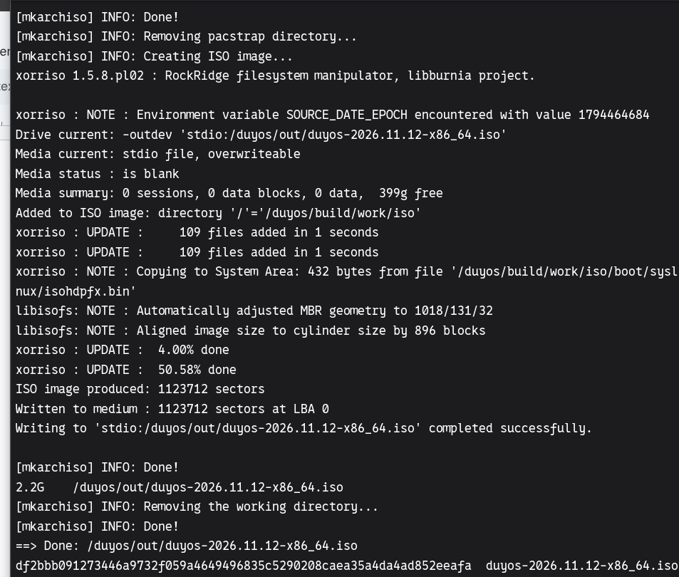
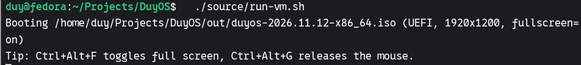
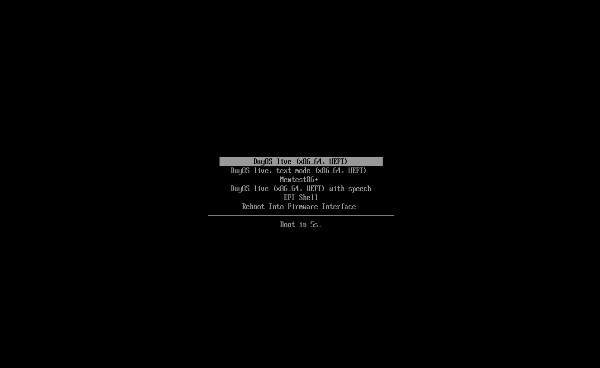
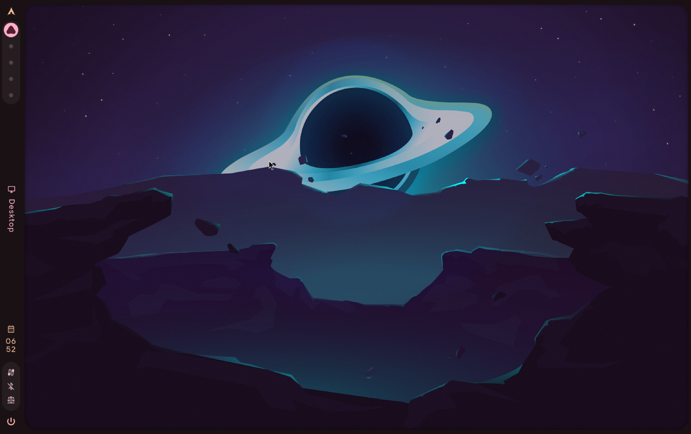
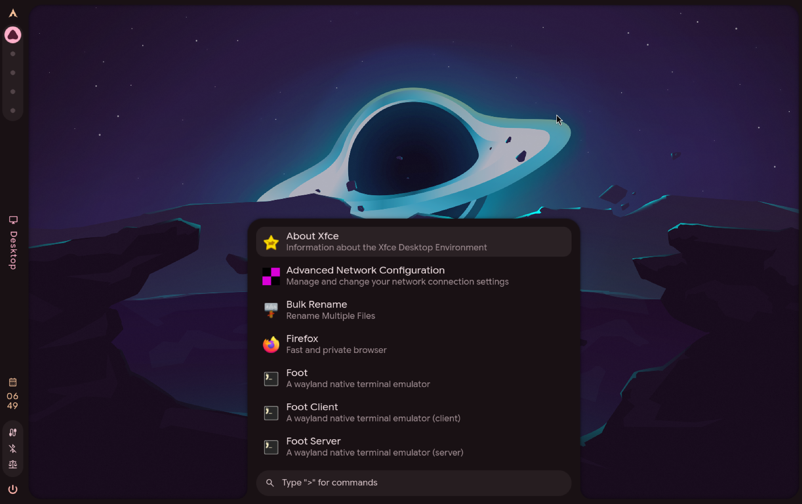
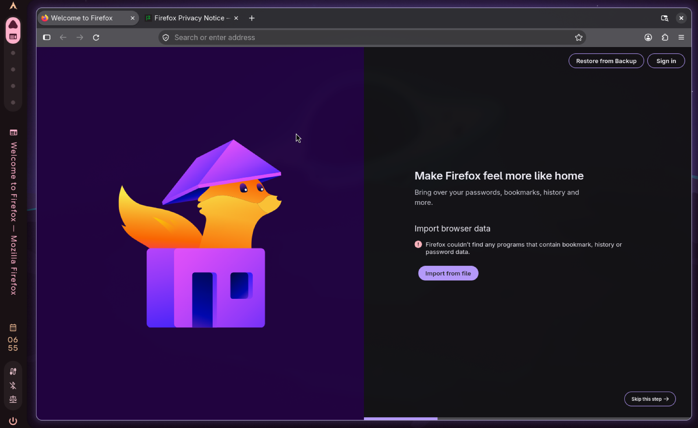
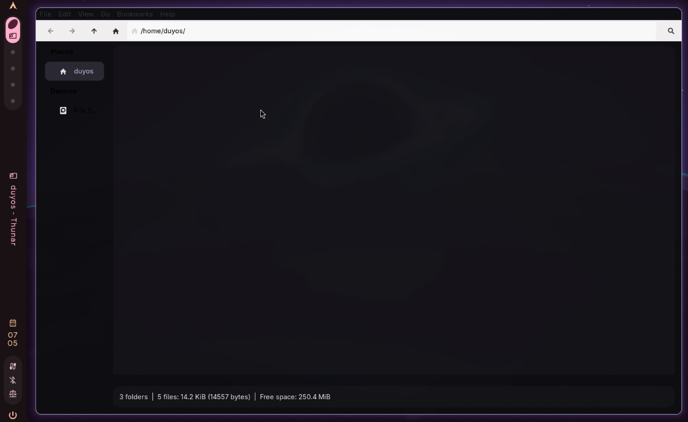
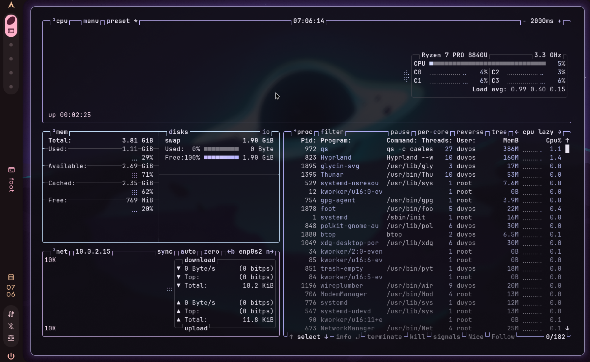
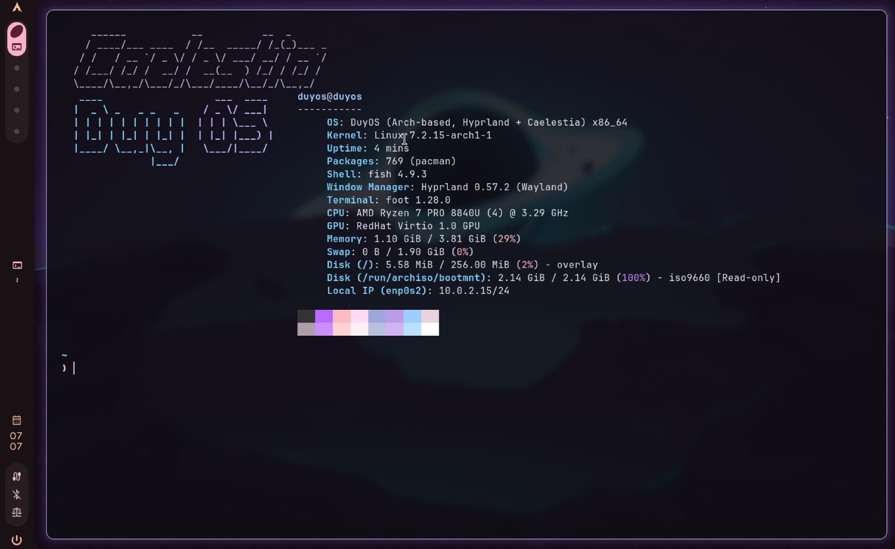
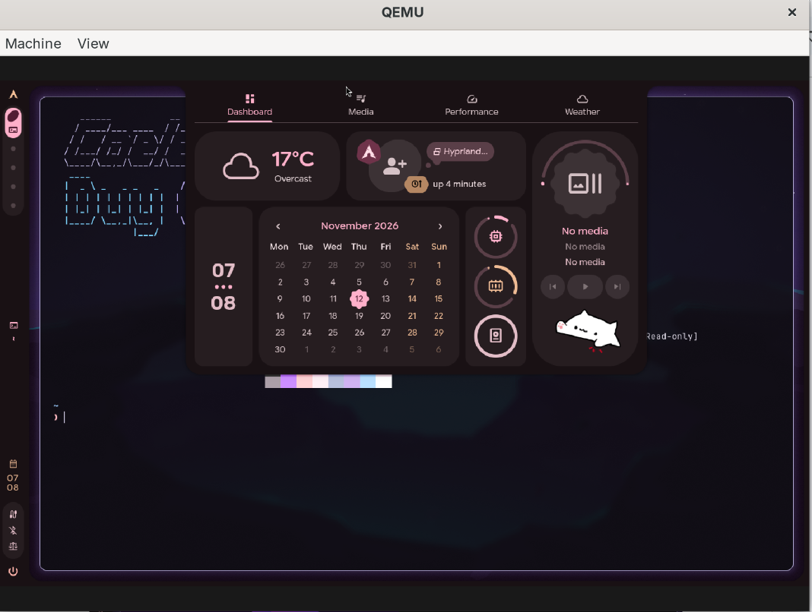

# DuyOS demo

Evidence of DuyOS building successfully and running in a virtual machine.

| Item | File |
|---|---|
| Full build log | `logs/build.log` (copied from `out/build-*.log`) |
| AUR package versions in this build | `logs/aur-manifest.txt` |
| ISO checksum | `logs/duyos.iso.sha256` |
| Screenshots | `screenshots/` |
| Video walkthrough | link: _add YouTube/Drive link here_ |

## Screenshots

| # | Screenshot | What it shows |
|---|---|---|
| 1 |  | **Building the ISO.** The end of `./source/build.sh`: `mkarchiso` writes `duyos-2026.11.12-x86_64.iso` (2.2 GB) and prints its SHA-256 checksum. |
| 2 |  | **Starting the VM.** `./source/run-vm.sh` boots the newest ISO in QEMU/KVM with UEFI firmware at 1920x1200. |
| 3 |  | **Boot menu.** The UEFI (systemd-boot) menu with the DuyOS entries, including the custom *text mode* entry, and the shortened 5-second timeout. |
| 4 |  | **Desktop.** DuyOS boots and logs in automatically to Hyprland running the Caelestia shell (bar on the left, Caelestia's default wallpaper). |
| 5 |  | **App launcher.** Caelestia's launcher (Super key) listing the preinstalled applications. |
| 6 |  | **Firefox**, a preinstalled package, running in the live session. |
| 7 |  | **Thunar** file manager, open in the live user's home `/home/duyos`. |
| 8 |  | **btop.** It shows the desktop running as the unprivileged `duyos` user (Hyprland, Caelestia `qs`, Thunar, foot), NetworkManager running, and the **1.9 GiB zram swap** (system-level modification). |
| 9 |  | **fastfetch** with the custom DuyOS logo: `OS: DuyOS (Arch-based, Hyprland + Caelestia)`, Hyprland 0.57.2, fish shell, foot terminal, and swap from zram. |
| 10 |  | **Running in a QEMU VM.** The QEMU window on the Fedora host with DuyOS inside showing the Caelestia dashboard. fastfetch in screenshot 9 also reports the virtual `RedHat Virtio 1.0 GPU`. |
